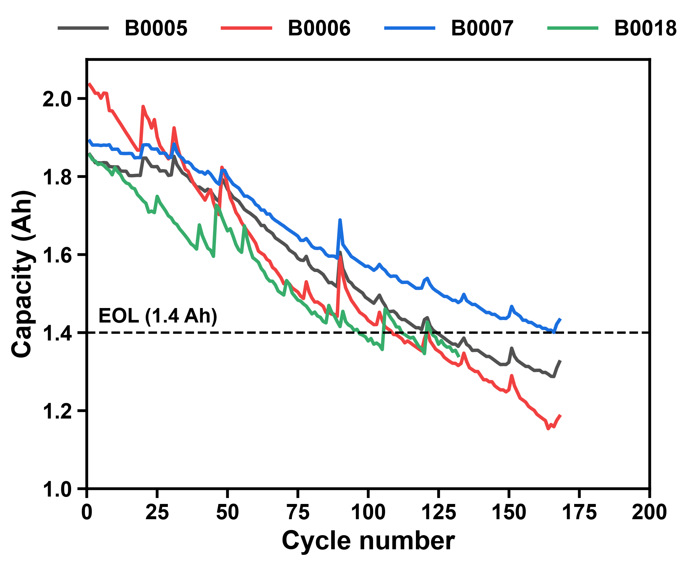
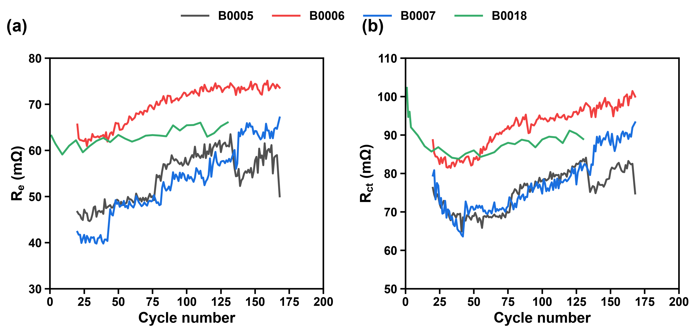
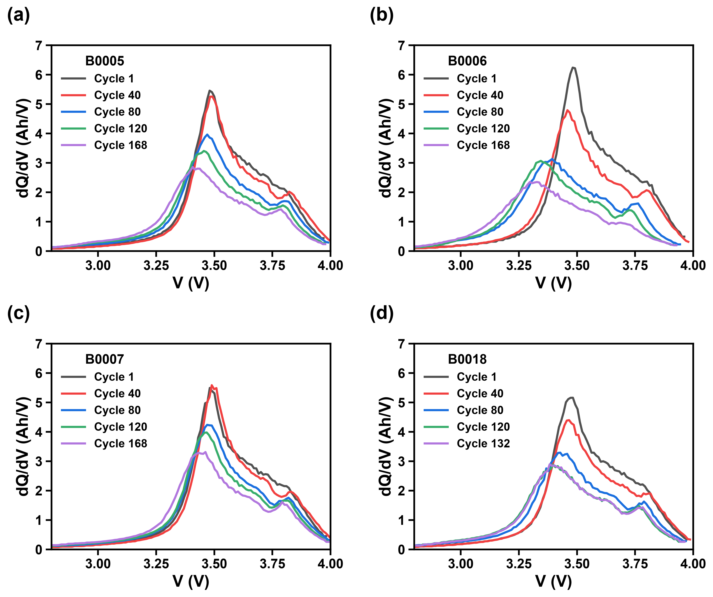

# NASA Battery Degradation Analyser

A Python tool that analyses how commercial Li-ion cells age, using the public
**NASA Ames Li-ion Battery Aging dataset**. It measures capacity fade, finds the
end-of-life cycle, tracks internal resistance (EIS), and uses **incremental
capacity analysis (dQ/dV)** to test *why* the capacity is lost.

Results are delivered as publication-style figures and formatted Excel reports,
all from one simple menu.



---

## Key findings

| Cell | Initial capacity (Ah) | Final capacity (Ah) | Fade vs initial | EOL at 80% (1.6 Ah) | EOL at 70% (1.4 Ah, NASA) |
|---|---|---|---|---|---|
| B0005 | 1.856 | 1.325 | 28.6% | cycle 75 | cycle 125 |
| B0006 | 2.035 | 1.186 | 41.7% | cycle 63 | cycle 109 |
| B0007 | 1.891 | 1.432 | 24.3% | cycle 86 | not reached |
| B0018 | 1.855 | 1.341 | 27.7% | cycle 45 | cycle 97 |

*EOL cycle = the first cycle below the limit. After long rests, capacity can briefly
rise above the limit again.*

1. **"Lifetime" depends on the end-of-life definition.** With the common industry
   limit (80% of rated capacity), the cells reach end of life 46–52 cycles
   earlier than with NASA's 70% limit (B0007 never reaches the 70% limit).
2. **Large cell-to-cell variation.** B0005, B0006 and B0007 were cycled together with
   the same currents, yet lost between 24% and 42% of their capacity (their discharge
   cut-off voltages differ; see Limitations).
3. **Capacity recovers briefly after long rests.** Every large upward jump
   (more than 0.04 Ah) follows a pause of 9–310 h (normally 4–5 h between discharges).
   The recovery is temporary.
4. **Internal resistance grows as capacity falls**
   (correlation r = −0.87 to −0.97 for B0005–B0007). Both change with cycle number,
   so this shows that they move together, not that one causes the other.
5. **Resistance is a symptom, not the main cause.** The dQ/dV curves *shrink* rather
   than only shifting in voltage. Even if the whole curve moved down by the full
   observed shift, this would explain only **0.6–1.4%** of the capacity lost: the
   charge is really missing.

---

## Figures

| Resistance growth (EIS) | Incremental capacity (dQ/dV) |
|---|---|
|  |  |

More figures in [`figures/`](figures/): capacity retention, cell temperature,
capacity vs resistance, and dQ/dV peak position and height vs cycle.

---

## Physics interpretation

**Capacity fade.** The cells were aged in an accelerated test: full cycles, charged at
1.5 A to 4.2 V and discharged at 2 A (1C) to the cut-off voltage, about three cycles
per day. Under these conditions the
main ageing process in Li-ion cells is usually the growth of the **solid electrolyte
interphase (SEI)** on the negative electrode. The SEI keeps consuming lithium and
electrolyte, so less lithium can shuttle between the electrodes. (The NASA README
does not give the cell chemistry, so this is the standard interpretation, not
something measured directly here.)

**Resistance growth.** EIS shows that both the electrolyte resistance R<sub>e</sub>
and the charge-transfer resistance R<sub>ct</sub> increase in B0005–B0007 (in B0018,
R<sub>ct</sub> ends slightly lower than at the start because of its early fall, while
R<sub>e</sub> still increases). The rise of R<sub>e</sub>
is consistent with side reactions consuming electrolyte. R<sub>ct</sub> first *falls*
until about cycle 40, then rises (for B0005–B0007 the first EIS test is at cycle 19,
so the earliest cycles are not covered). The early fall is often explained as
an activation stage (better wetting of the electrodes, more active surface), and the
later rise as a thickening interface layer.

**Is the capacity lost because of the higher resistance?** Mostly not. A higher
resistance lowers the voltage by I·ΔR, so the cell reaches the cut-off voltage
earlier. But the voltage falls very steeply at the end of discharge, so this
effect is small. The dQ/dV analysis gives an independent check. A pure resistance
effect would move the dQ/dV curve to lower voltage without making it smaller. Even if
the whole curve moved down by the full observed peak shift (53–190 mV), this would
explain only 0.6–1.4% of the capacity loss, so the rest of the charge is really
missing. The curves also keep the same features (no new peaks appear, none
disappear), so the same electrode reactions still take place, only with less charge.
In three of the four cells the peak moves more than the EIS resistance
predicts. Two likely reasons: EIS (down to 0.1 Hz) misses slow processes such as
diffusion inside the electrode particles, and in a full cell the loss of lithium itself
changes how the two electrodes line up, which also moves the peaks.

The most likely explanation is that one process, SEI growth, causes **both**
effects: trapped lithium (capacity fade) and a thicker, more resistive layer
(resistance growth). This fits all the results, but the data cannot prove which
mechanism removes the charge (see Limitations).

**Temperature.** The cells reach 36–42 °C during discharge, and the maximum rises by
0.5–2.3 °C over the test, which fits more I²R heating. However, cells tested at the
same time rise and fall together, so room temperature also affects this signal.

### Limitations

- Only 4 cells: the trends are clear, but there are no statistics on cell-to-cell variation.
- The cut-off voltages differ (2.7 / 2.5 / 2.2 / 2.5 V). This changes the *measured*
  capacity by at most ~1.7%. A deeper discharge can also make a cell age faster, but
  the fade does not follow the cut-off order (B0007, with the lowest cut-off, faded
  the least), so the cut-off alone does not explain the differences. It cannot be
  excluded as one factor.
- Re and Rct are the values estimated by NASA. The raw impedance spectra were not refitted.
  Some sudden steps in Re appear at the same cycles in cells tested together, which
  suggests effects of the test setup.
- dQ/dV at 1C gives broad peaks. Separating *loss of lithium* from *loss of active
  material* would need slow (C/20) cycles or electrode reference data.

---

## Dataset

**Source:** B. Saha and K. Goebel (2007). *Battery Data Set*, NASA Prognostics Data
Repository, NASA Ames Research Center, Moffett Field, CA.
[NASA PCoE data set repository](https://www.nasa.gov/intelligent-systems-division/discovery-and-systems-health/pcoe/pcoe-data-set-repository/)

- Cells B0005, B0006, B0007 and B0018 (rated capacity 2.0 Ah), room temperature
- Charge: constant current 1.5 A to 4.2 V, then constant voltage until 20 mA
- Discharge: constant current 2 A until 2.7 / 2.5 / 2.2 / 2.5 V
- EIS: 0.1 Hz – 5 kHz
- NASA end-of-life criterion: 30% capacity fade (2.0 Ah → 1.4 Ah)

The raw data files are **not** included in this repository.

---

## How to run it

**1. Get the code and install the packages** (Python 3.12, Windows commands):

```
git clone <this repository's URL>
cd <repository folder>
python -m venv .venv
.venv\Scripts\python.exe -m pip install -r requirements.txt
```

**2. Download the data.**
Download `5. Battery Data Set` from the
[NASA PCoE repository](https://www.nasa.gov/intelligent-systems-division/discovery-and-systems-health/pcoe/pcoe-data-set-repository/).
Inside it, open `1. BatteryAgingARC-FY08Q4.zip` and copy `B0005.mat`, `B0006.mat`,
`B0007.mat`, `B0018.mat` (and `README.txt`) into the `data/` folder.

**3. Start the menu:**

```
.venv\Scripts\python.exe src\main.py
```

```
  1. Capacity: capacity, retention, temperature (+ Excel)
  2. Resistance: Re and Rct vs cycle, EIS (+ Excel)
  3. dQ/dV: incremental capacity analysis (+ Excel)
  4. Run everything (1 + 2 + 3)
  5. Open the figures folder
  6. Open the results folder (Excel reports)
  0. Exit
```

Figures are saved in `figures/` (PNG, 300 dpi). Tables are saved in `results/`, as CSV
files and as formatted Excel reports (`capacity_analysis.xlsx`,
`resistance_analysis.xlsx`, `dqdv_analysis.xlsx`).

---

## Project structure

```
├── data/              raw NASA .mat files (not in the repository)
├── src/
│   ├── load_data.py   reads the .mat files into pandas tables
│   ├── analysis.py    capacity retention, end of life, resistance trends
│   ├── dqdv.py        incremental capacity analysis (dQ/dV)
│   ├── plots.py       all figures, one consistent style
│   ├── excel_report.py formatted Excel reports
│   └── main.py        the numbered menu
├── figures/           saved figures
├── results/           CSV tables and Excel reports
├── requirements.txt
└── LICENSE            MIT license (for the code)
```

---

## About this project

I am a physics graduate (University of Patras, Greece) interested in battery and
energy storage R&D.

My BSc thesis studied **lithium titanate (Li₄Ti₅O₁₂) thin films as the
electrochromic layer of smart windows**, characterised with cyclic voltammetry and
galvanostatic charge–discharge. An electrochromic device works like a thin-film
battery: ions and electrons are inserted to colour it, and the stored charge fades
with cycling. This project applies the same questions (*how fast is charge lost, and
why?*) to commercial Li-ion cells, using public data.

The plot style follows the figures of my thesis.

**Built with AI assistance:** I guided this project and used Claude Code (Anthropic) as
my assistant. Under my guidance, it wrote the code and helped me write this README. I
chose the questions to study, decided the analysis steps and the output format, and
checked every result and the physics interpretation against my electrochemistry
background. I used the project to learn to read and edit Python.
